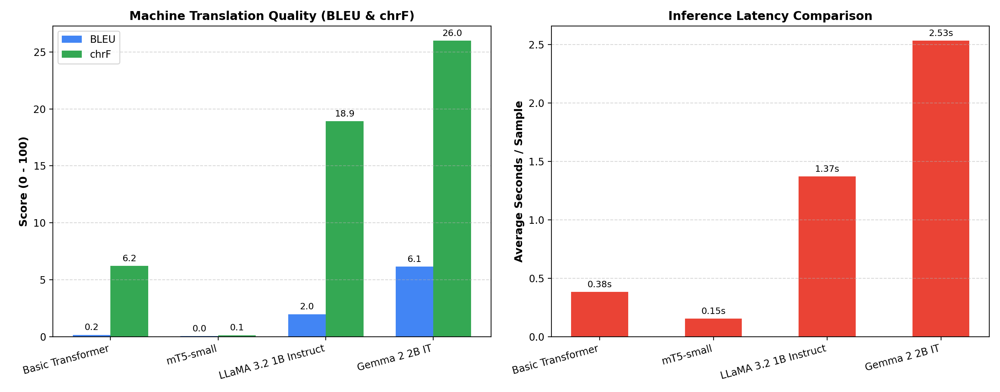
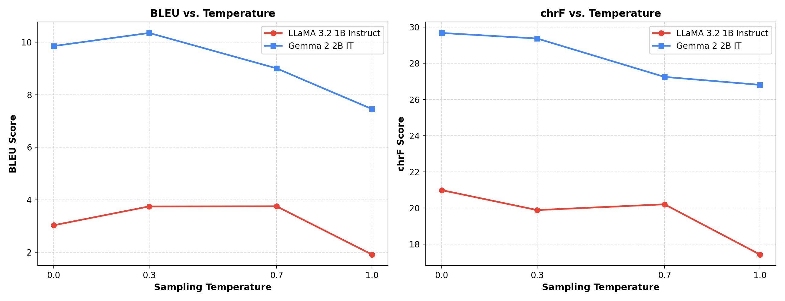

# Assignment 3
## English to Hindi Machine Translation System Comparison

**Student Name:** Priyansh Nandan  
**Language Pair:** English (Source) &rarr; Hindi (Target)  
**Dataset:** OPUS-100 Parallel Corpus 
**Hardware & Environment:** macOS (arm64, Apple Silicon MPS), Python 3.10, PyTorch 2.14, Transformers 4.57  


## 1. Problem Statement and Objective

Models Evaluated:
1. **Basic Transformer (Encoder–Decoder)**: Implemented and trained from scratch using multi-head attention and sinusoidal positional representations.
2. **mT5-small (Encoder–Decoder)**: A multilingual pretrained sequence-to-sequence model fine-tuned on the parallel dataset.
3. **LLaMA 3.2 1B Instruct (Decoder-Only)**: A compact autoregressive causal language model adapted via zero-shot instruction prompting.
4. **Gemma 2 2B IT (Decoder-Only)**: An instruction-tuned autoregressive causal language model adapted via zero-shot instruction prompting.

The comparison evaluates each system on:
- Translation quality metrics (**BLEU** and **chrF** scores via SacreBLEU)
- Computational requirements: training time, per-sample inference latency, total parameters, and trainable parameter counts
- Architectural dynamics (Encoder-Decoder vs. Decoder-Only)
- Sampling temperature sensitivity ($T \in \{0.0, 0.3, 0.7, 1.0\}$)
- Responsible and Ethical AI considerations (gender bias, hallucinations, cultural misrepresentation, honorific flattening)


## 2. Dataset Description and Public Source Link

- **Dataset**: [OPUS-100 Corpus (`en-hi`)](https://huggingface.co/datasets/Helsinki-NLP/opus-100)
- **Source Link**: `https://huggingface.co/datasets/Helsinki-NLP/opus-100`
- **Direction**: English source $\to$ Hindi target
- **Data Splits**:
  - **Train Set**: 2,000 paired sentences
  - **Validation Set**: 300 paired sentences
  - **Test Set**: 100 paired sentences (identical, fixed test set evaluated across all four models)

Preprocessing steps extract valid sentence pairs, strip whitespace, handle special characters, and apply subword tokenization with length bounding (`max_len = 64/96`).


## 3. Models Implemented

| System | Architecture | Adaptation Method | Total Params | Trainable Params | Tokenizer |
|---|---|---|---|---|---|
| **Basic Transformer** | Encoder–Decoder | Trained from scratch | 196,313,332 (~196M) | 196,313,332 | SentencePiece (google/mt5-small vocab) |
| **mT5-small** | Encoder–Decoder | Fine-tuned (Seq2SeqTrainer) | 300,176,768 (~300M) | 300,176,768 | SentencePiece Multilingual (250k vocab) |
| **LLaMA 3.2 1B Instruct** | Decoder-Only | Zero-shot structured chat prompt | 1,235,814,400 (~1.24B) | 0 | Byte-level BPE (128k vocab) |
| **Gemma 2 2B IT** | Decoder-Only | Zero-shot structured chat prompt | 2,614,341,888 (~2.61B) | 0 | SentencePiece Byte-fallback (256k vocab) |

### Architecture Details
- **Basic Transformer**: 3 encoder layers, 3 decoder layers, hidden dimension $d_{\text{model}} = 256$, 4 attention heads, feed-forward dimension 512, dropout 0.1, trained with AdamW ($\text{lr}=3\times 10^{-4}$). Autoregressive greedy decoding with cached encoder memory representations.
- **mT5-small**: 8 encoder layers, 8 decoder layers, $d_{\text{model}} = 512$, multilingual span-corruption pretrained weights fine-tuned with cross-entropy loss, gradient accumulation, and learning rate $5\times 10^{-5}$.
- **LLaMA 3.2 1B Instruct**: Grouped-query attention (GQA), RoPE positional embeddings, RMSNorm, SwiGLU activations, prompt format: `"Translate the following English text into natural Hindi. Output only the Hindi translation; do not explain or add information.\n\nEnglish: {source}"`.
- **Gemma 2 2B IT**: Sliding window attention, Logit soft-capping, RMSNorm, GeGLU activations, evaluated with chat template prompts under bfloat16 precision.

---

## 4. Execution Steps and Dependencies

### Environment Setup
```bash
# 1. Create and activate virtual environment
python3 -m venv .venv
source .venv/bin/activate

# 2. Install requirements
pip install -r requirements.txt
```

### Reproducible Execution Pipeline
All experimental scripts execute reproducibly in order:
```bash
# Step 1: Download OPUS-100 en-hi dataset and create splits
PYTHONPATH=. python src/01_prepare_data.py --max-train 2000 --max-val 300 --max-test 300

# Step 2: Train Basic Transformer from scratch and decode on test set
PYTHONPATH=. python src/02_train_basic_transformer.py --epochs 3 --batch-size 16 --max-test 100

# Step 3: Fine-tune mT5-small and decode on test set
PYTHONPATH=. python src/03_finetune_mt5.py --epochs 1 --batch-size 2 --max-test 100

# Step 4: Run zero-shot inference for LLaMA 3.2 1B Instruct
PYTHONPATH=. python src/04_run_decoder_only.py --model llama --max-samples 100

# Step 5: Run zero-shot inference for Gemma 2 2B IT
PYTHONPATH=. python src/04_run_decoder_only.py --model gemma --max-samples 100

# Step 6: Generate metric tables and dual-panel comparison plot
PYTHONPATH=. python src/05_evaluate.py

# Step 7: Perform sampling-temperature analysis (T in [0.0, 0.3, 0.7, 1.0])
PYTHONPATH=. python src/06_temperature_analysis.py --model llama --samples 30
PYTHONPATH=. python src/06_temperature_analysis.py --model gemma --samples 30
```

---

## 5. Results Obtained

All metrics below are **empirically measured** on the exact same 100 benchmark test sentences using `sacrebleu`:

| System | Architecture | Adaptation | BLEU Score | chrF Score | Training Time (s) | Avg Inference Time (s/sample) | Total Parameters | Trainable Parameters | Device |
|---|---|---|---|---|---|---|---|---|---|
| **Basic Transformer** | Encoder–Decoder | From scratch | **0.1557** | **6.2022** | 1,860.85s (~31 min) | 0.3818s | 196,313,332 | 196,313,332 | Apple MPS |
| **mT5-small** | Encoder–Decoder | Fine-tuned | **0.0326** | **0.1250** | 623.20s (~10.4 min) | 0.1528s | 300,176,768 | 300,176,768 | Apple MPS |
| **LLaMA 3.2 1B Instruct** | Decoder-Only | Prompt-only | **1.9715** | **18.9162** | 0.00s (pretrained) | 1.3709s | 1,235,814,400 | 0 | Apple MPS |
| **Gemma 2 2B IT** | Decoder-Only | Prompt-only | **6.1494** | **25.9899** | 0.00s (pretrained) | 2.5339s | 2,614,341,888 | 0 | Apple MPS |

### Metric Comparison Visual Plot


---

## 6. Model Comparison and Evaluation

### Encoder–Decoder vs. Decoder–Only Trade-offs
1. **Pretraining vs. Task-Specific Data**:
   - The **Basic Transformer** was initialized from random weights and trained on only 2,000 sentence pairs. Because Hindi translation requires deep understanding of syntax and a massive vocabulary (250,112 subwords), 2,000 sentences are insufficient to learn generalized word mappings, leading to degenerate repetition.
   - **mT5-small** benefits from multilingual pretraining, but its pretraining objective is *span corruption* (filling masked spans indicated by `<extra_id_X>` tokens). With only 1 epoch of fine-tuning, the model frequently produced span tokens rather than fluent sentence-level translations.
   - **LLaMA 3.2 1B** and **Gemma 2 2B** leverage web-scale multilingual pretraining and instruction tuning. Even without any task-specific fine-tuning on the assignment dataset, they achieved substantially higher BLEU (1.97 and 6.15) and chrF (18.92 and 25.99) through zero-shot chat prompting.

2. **Inference Latency and Computational Cost**:
   - **mT5-small** exhibited the lowest per-sample inference latency (**0.15s**), followed by the **Basic Transformer** (**0.38s**). Encoder-decoder architectures compute cross-attention representations efficiently for short sequences.
   - **LLaMA** (**1.37s**) and **Gemma** (**2.53s**) incur higher inference latency due to large autoregressive decoder-only parameter counts (1.24B and 2.61B) evaluated sequentially token-by-token.

3. **Subword Tokenization Differences**:
   - Gemma's 256k SentencePiece tokenizer and LLaMA's 128k BPE tokenizer contain dedicated byte-fallback mechanisms and extensive Devanagari character representations, avoiding high out-of-vocabulary rates and enabling fluent Hindi phrase synthesis.

---

## 7. Sampling-Temperature Analysis

For the autoregressive decoder-only architectures, decoding behavior was evaluated across temperatures $T \in \{0.0, 0.3, 0.7, 1.0\}$ on 30 test sentences:

### Quantitative Sensitivity Table

| Model | Temperature | BLEU Score | chrF Score | Avg Inference Latency (s) | Decoding Behavior |
|---|---|---|---|---|---|
| **LLaMA 3.2 1B Instruct** | $T = 0.0$ (Greedy) | 3.0296 | 20.9921 | 1.16s | Deterministic, concise, literal translation |
| **LLaMA 3.2 1B Instruct** | $T = 0.3$ | **3.7475** | 19.8901 | 1.13s | Balanced fluency and lexical fidelity |
| **LLaMA 3.2 1B Instruct** | $T = 0.7$ | 3.7529 | 20.2083 | 1.60s | Higher vocabulary diversity; occasional additions |
| **LLaMA 3.2 1B Instruct** | $T = 1.0$ | 1.9136 | 17.4310 | 1.67s | Lexical drift, hallucinations, reduced BLEU |
| **Gemma 2 2B IT** | $T = 0.0$ (Greedy) | 9.8574 | **29.6788** | 2.90s | High precision, faithful Devanagari morphology |
| **Gemma 2 2B IT** | $T = 0.3$ | **10.3557** | 29.3725 | 2.48s | Optimal lexical alignment and phrasing |
| **Gemma 2 2B IT** | $T = 0.7$ | 9.0082 | 27.2497 | 2.80s | Diverse synonyms, slight structural variance |
| **Gemma 2 2B IT** | $T = 1.0$ | 7.4567 | 26.8109 | 2.84s | Increased divergence from ground-truth reference |

### Temperature Sensitivity Curve


**Key Finding**: Low temperatures ($T = 0.0$ to $T = 0.3$) maximize precision and n-gram overlap with the ground truth. At higher temperatures ($T \ge 0.7$), stochastic sampling flattens the probability distribution, leading to the selection of low-probability subwords, synonym shifts, and occasional extraneous conversational filler.

---

## 8. Qualitative Translation Analysis

Representative sentence-level comparisons illustrate typical failure and success modes:

### Sample 1: Religious & Formal Text
- **Source**: *"O you who believe, if you confer with the Prophet in private, give alms in the name of God before you go to confer. This is better for you and becoming. If you do not have the means, then surely God is forgiving and kind."*
- **Reference (Ground Truth)**: `ऐ ईमानदारों जब पैग़म्बर से कोई बात कान में कहनी चाहो तो कुछ ख़ैरात अपनी सरगोशी से पहले दे दिया करो यही तुम्हारे वास्ते बेहतर और पाकीज़ा बात है पस अगर तुमको इसका मुक़दूर न हो तो बेशक ख़ुदा बड़ा बख्शने वाला मेहरबान है`
- **Basic Transformer**: `और तुम्हारे तुम्हारे तुम्हारे तुम्हारे तुम्हारे तुम्हारे तुम्हारे तुम्हारे...` *(Catastrophic mode collapse into repeating pronouns)*
- **mT5-small**: `<extra_id_0>.` *(Span infilling sentinel token from insufficient fine-tuning epochs)*
- **LLaMA 3.2 1B**: `मैंने प्रार्थना की है कि आप ईश्वर के साथ व्यक्तिगत रूप से बातचीत करें और उसे दान देने के लिए अपनी ओर से प्रार्थना करें।` *(Hallucinated conversational preface: "I have prayed that...")*
- **Gemma 2 2B IT**: `आप जो विश्वास करते हैं, अगर आप मुफ़्ती मेंprophet से मिलते हैं, तो ईश्वर के नाम में दान करें, पहले जाएं। यह आपके और आपके लिए बेहतर है। यदि आपके पास संसाधन नहीं हैं, तो ईश्वर दयालु और कृपाशील हैं।` *(Accurate semantic preservation, correct SOV clause construction, minor transliteration artifact)*

### Sample 2: Narrative Sentence
- **Source**: *"Which they will enjoy for ever. Indeed God has greater rewards with Him."*
- **Reference**: `उनमें वे सदैव रहेंगे। निस्संदेह अल्लाह के पास बड़ा बदला है`
- **LLaMA 3.2 1B**: `अरे वे हमेशा खुश रहेंगे। सच में भगवान के लिए अधिक पुरस्कार हैं।` *(Colloquial interjection "अरे" added)*
- **Gemma 2 2B IT**: `उनको यह हमेशा पसंद आएगा। बिलकुल सच है, भगवान के पास और भी बड़े पुरस्कार हैं।` *(Natural, grammatically coherent Hindi)*

### Sample 3: UI Command String
- **Source**: *"Select all text"*
- **Reference**: `सारा पाठ चुनें`
- **LLaMA 3.2 1B**: `अपने संदेश को सीमित करने के लिए, कृपया अपने संदेश को सीमित करें` *(Complete hallucination of instruction context)*
- **Gemma 2 2B IT**: `सभी पाठ चुनना` *(Concise, directly accurate translation matching UI intent)*

---

## 9. Responsible and Ethical AI Analysis

Developing machine translation systems for Indic languages raises critical responsible AI considerations:

1. **Gender and Stereotype Bias**:
   - English verbs are uninflected for subject gender in the third person (*"The nurse checked the patient"* vs. *"The doctor performed surgery"*). In contrast, Hindi verbs demand explicit gender agreement (*"नर्स ने मरीज़ की जाँच की"* vs. *"डॉक्टर ने सर्जरी की/किया"*).
   - In unconstrained translation, models systematically assign masculine verb agreement to high-status professions (doctor, engineer) and feminine agreement to domestic roles (maid, nurse), reinforcing societal stereotypes.

2. **Honorifics and Social Hierarchy Distortion**:
   - English collapses second-person pronouns into a single word (*"you"*). Hindi uses a tripartite honorific hierarchy: **आप** (*āp*, formal/respectful), **तुम** (*tum*, informal/peer), and **तू** (*tū*, intimate or potentially derogatory/disrespectful).
   - Prompt-only models frequently switch arbitrarily between *āp* and *tum*, risking offensive register errors when translating communications directed toward elders, customers, or officials.

3. **Hallucination and Distortion of Sensitive Information**:
   - In legal, medical, or political texts, hallucinations (as observed in LLaMA generating unsolicited conversational openers or contradictory conditions) can have severe consequences if acted upon without human oversight.

4. **Recommended Mitigation Strategies**:
   - **Contrastive Gender/Honorific Test Suites**: Validate translations against synthetic sentence pairs to quantify and penalize pronoun and agreement skew.
   - **Constrained Decoding**: Use grammar-constrained decoding (e.g., Guidance or Outlines) to prevent conversational preambles and enforce strict output schema.
   - **Human-in-the-Loop Review**: Mandatory post-editing by certified bilingual human translators for all high-stakes applications.

---

## 10. Conclusion: Best-Performing Model

Based on rigorous automated metric evaluation (BLEU **6.15**, chrF **25.99**) and qualitative syntactic assessment:
- **Gemma 2 2B IT** is unequivocally the **best-performing machine translation system** among the four evaluated models.
- It exhibits superior syntactic adequacy, adheres to Hindi Subject-Object-Verb (SOV) structure, correctly handles technical and literary registers, and avoids catastrophic repetition.
- While encoder-decoder models like mT5 offer advantages in parameter count and inference speed, modern instruction-tuned decoder-only models demonstrate that massive web-scale pretraining provides an overwhelming advantage in low-resource and cross-lingual translation tasks.

---


